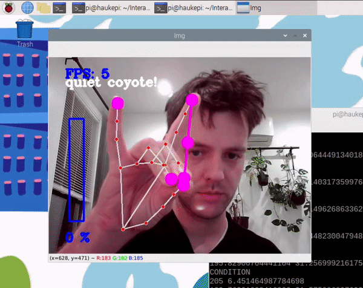

# Observant Systems: Overnight Sensation

**NAMES OF COLLABORATORS HERE**

For lab this week, we focus on creating interactive systems that can detect and respond to events or stimuli in the environment of the Pi, like the Boat Detector we mentioned in lecture. 
Your **observant device** could, for example, count items, find objects, recognize an event or continuously monitor a room.

This lab will help you think through the design of observant systems, particularly corner cases that the algorithms need to be aware of.

**New this year: the AI runs on the Pi.** Your Pi 5 can run an object detector ([YOLO](https://docs.ultralytics.com/)) and a small language model ([Qwen](https://ollama.com/library/qwen3.5) through [Ollama](https://ollama.com)) completely offline. In Part 1 you get both running and connect them: YOLO *sees*, Qwen *reasons* about what was seen. These models are slow, but they have all night. In Part 2 you use them to design a **night-time interaction**: what you tell the device before bed, what it does while you sleep, and what it shows you when you wake up.

**Please indicate anyone you collaborated with on this Lab here.**
Be generous in acknowledging their contributions! And also recognizing any other influences (e.g. from YouTube, Github, Twitter) that informed your design. 

## Overview

**Part 1: the tools**

A) [Set up your Pi for on-device AI](#part-a)

B) [See: recognize people in real time with YOLO](#part-b)

C) [See more: hands and pose with MediaPipe](#part-c)

D) [Reason: run Qwen on the Pi with Ollama](#part-d)

E) [Connect: from YOLO readings to Qwen reasoning](#part-e)

**Part 2: Overnight Sensation**

F) [Read Part 2 and storyboard your night-time interaction](#part-f)

G) [Design the interaction before bed](#part-g)

H) [Incorporate the observant system during sleep](#part-h)

I) [Design the interaction when awake](#part-i)

The tools from earlier versions of this lab (MobileNet, Teachable Machine, Moondream, audio analysis, classic OpenCV) live in the [legacy folder](legacy/README.md). They are optional, but any of them can be the sensor in your Part 2 system.


## Prep for Part 1

Please check the instructions in [prep.md](prep.md) and complete them before lab. The installs in Part A take a while, so prep.md also tells you how to get a head start.

## The Report

This readme.md page in your own repository should be edited to include the work you have done. You can delete everything but the headers and the sections between the \*\*\***stars**\*\*\*. Write the answers to the questions under the starred sentences. Include any material that explains what you did in this lab hub folder, and link it in the readme.

---

# Part 1

## Part A. 
### Set up your Pi for on-device AI

Create a virtual environment and install the requirements. They include `ultralytics` (YOLO), which pulls in torch, so this takes a while:

```
pi@raspberrypi:~$ cd Interactive-Lab-Hub/Lab\ 5
pi@raspberrypi:~/Interactive-Lab-Hub/Lab 5 $ python3 -m venv .venv
pi@raspberrypi:~/Interactive-Lab-Hub/Lab 5 $ source .venv/bin/activate
(.venv) pi@raspberrypi:~/Interactive-Lab-Hub/Lab 5 $ pip install -r requirements.txt
```

As in Lab 3, [`uv`](https://docs.astral.sh/uv/) is a much faster drop-in for `pip`: `pip install uv && uv pip install -r requirements.txt`.

### YOLO: download the nano model and export it for the Pi

We use the nano model of [YOLO26](https://docs.ultralytics.com/models/yolo26/), exported once to NCNN, the format that runs fastest on the Pi. This downloads the weights, so you need internet:

```
(.venv) pi@raspberrypi:~/Interactive-Lab-Hub/Lab 5 $ python -c "from ultralytics import YOLO; YOLO('yolo26n.pt').export(format='ncnn')"
```

Test it on an image from the internet. `project=runs` keeps the output in this folder; without it, ultralytics writes to a `runs/` folder at the top of your git repo, where you will not think to look.

```
(.venv) pi@raspberrypi:~/Interactive-Lab-Hub/Lab 5 $ yolo predict model=yolo26n_ncnn_model source=https://ultralytics.com/images/bus.jpg project=runs
```

The result is in `runs/predict/bus.jpg`: boxes around the people and the bus.

Now a photo of your own. Plug in the webcam and take one with `snap.py` (`--delay 3` gives you three seconds to get into the frame), or copy a photo from your phone to the Pi with `scp`. Then run the same command on it:

```
(.venv) pi@raspberrypi:~/Interactive-Lab-Hub/Lab 5 $ python snap.py --delay 3
(.venv) pi@raspberrypi:~/Interactive-Lab-Hub/Lab 5 $ yolo predict model=yolo26n_ncnn_model source=snap.jpg project=runs
```

Every run gets its own numbered folder, so this one is in `runs/predict2/snap.jpg`; the command prints where it saved. Keep `snap.jpg`, you will show it to Qwen in Part D.

### Ollama: install it and pull Qwen

[Ollama](https://ollama.com) runs language models locally. Nothing leaves the Pi: no API key, no internet after the download.

```
pi@raspberrypi:~ $ curl -fsSL https://ollama.com/install.sh | sh
pi@raspberrypi:~ $ ollama pull qwen3.5:0.8b
pi@raspberrypi:~ $ ollama pull qwen3:0.6b
pi@raspberrypi:~ $ ollama list
```

| model | download | what it does |
|---|---|---|
| `qwen3.5:0.8b` | ~1.3 GB | text **and images**; the one we use in this lab |
| `qwen3:0.6b` | ~0.5 GB | text only, smaller and faster (~16 tokens/s on a Pi 5) |

\*\*\***Include a screenshot of `ollama list` showing your models, and the `bus.jpg` result and your own photo with their boxes.**\*\*\*


## Part B. 
### See: recognize people in real time with YOLO

YOLO is an *object detector*: it finds every person, cup, cat and so on (the 80 [COCO](https://cocodataset.org/) classes), draws a box around each, and gives a confidence. For an observant system that is exactly what you want: *how many*, *where*, *how sure*.

Connect your webcam, connect to your Pi through **VNC** (the script opens a window), and run the person detector. Read `yolo_person.py` first; the loop at the bottom is the whole idea.

```
(.venv) pi@raspberrypi:~/Interactive-Lab-Hub/Lab 5 $ python yolo_person.py
```

While it runs, walk in and out of the frame, sit down, turn your back, turn the lights off, hold up a photo of a person on your phone. Watch the confidence number on the box change with each.

Then press q to quit and run it again with a flag. Each one changes a single thing:

```
(.venv) pi@raspberrypi:~/Interactive-Lab-Hub/Lab 5 $ python yolo_person.py --conf 0.2     # lower the bar: see what the model is unsure about
(.venv) pi@raspberrypi:~/Interactive-Lab-Hub/Lab 5 $ python yolo_person.py --conf 0.7     # raise the bar: see what you lose
(.venv) pi@raspberrypi:~/Interactive-Lab-Hub/Lab 5 $ python yolo_person.py --all          # all 80 classes, not only people: what else is on your desk, and what does it get wrong?
(.venv) pi@raspberrypi:~/Interactive-Lab-Hub/Lab 5 $ python yolo_person.py --headless     # no window, only the printed readings: how it runs over ssh, and at night
```

\*\*\***Include a short video or screenshots of the person detection. Write down three situations where it did not see you, or saw a person who was not there, and what you think the cause was.**\*\*\*


## Part C. 
### See more: hands and pose with MediaPipe

YOLO tells you that a person is there. Google's [MediaPipe](https://mediapipe.dev/) tells you what their hands and body are doing: face, hand and body pose detection, fast on the Pi.



The demo plays a looping audio file, so make the helper script executable first:

```
(.venv) pi@raspberrypi:~/Interactive-Lab-Hub/Lab 5 $ chmod +x loop_audio.sh
```

Connect your webcam, connect to your Pi through **VNC**, and run the hand pose script:
(***it will not work if you use ssh from your laptop***)

```
(.venv) pi@raspberrypi:~/Interactive-Lab-Hub/Lab 5 $ python hand_pose.py
```

Try the two main features of this script: 1) pinching for percentage control (the thumb-to-index distance sets the volume), and 2) "[Quiet Coyote](https://www.youtube.com/watch?v=qsKlNVpY7zg)" for instant percentage setting (the gesture mutes it). Notice how this example uses hardcoded positions and relates those positions with a desired set of events, in `hand_pose.py`: a hand is 21 landmark coordinates, and an *event* is a rule you write over them. That is the same job as `interpret()` in Part E.

Consider how you might use this position based approach to create an interaction, and write how you might use it on either face, hand or body pose tracking.

\*\*\***Include a screenshot or short video of the hand pose demo, and write how you might use face, hand or body pose tracking in your observant system.**\*\*\*


## Part D. 
### Reason: run Qwen on the Pi with Ollama

Talk to the model in the terminal first. Qwen3 models "think" before they answer, which is slow on a Pi, so turn it off. Then ask about something you can check:

```
pi@raspberrypi:~ $ ollama run qwen3.5:0.8b
>>> /set nothink
>>> Tell me a bit about the history of Roosevelt Island. Three sentences.
>>> /bye
```

Roosevelt Island is a good first question because you know the ground truth: it was Blackwell's Island, then Welfare Island, got its current name in 1973, and Cornell Tech opened on it in 2017. Count how many of the model's facts are true.

From Python it is a dozen lines with `requests`; `ask_qwen.py` is that script. It turns thinking off, tells the model to answer in at most three sentences, and cuts it off after 120 tokens (`--max-tokens` changes that), because a small model left alone writes an essay. Read it, then run:

```
(.venv) pi@raspberrypi:~/Interactive-Lab-Hub/Lab 5 $ python ask_qwen.py "Tell me a bit about the history of Roosevelt Island."
(.venv) pi@raspberrypi:~/Interactive-Lab-Hub/Lab 5 $ python ask_qwen.py --model qwen3:0.6b "Tell me a bit about the history of Roosevelt Island."
(.venv) pi@raspberrypi:~/Interactive-Lab-Hub/Lab 5 $ python ask_qwen.py --image snap.jpg "What is in this photo?"
```

Four things in the [Ollama API](https://github.com/ollama/ollama/blob/main/docs/api.md) worth knowing:

* `think: false` skips the reasoning trace. Always, on a Pi. `ask_qwen.py` sends it on every request; `--think` turns the trace back on for one question, so you can see what you are skipping and how long it takes.
* `options.num_predict` is a hard cap on the answer length, in tokens. The model does not know about it, so it may stop mid-sentence; the `system` prompt is what asks it to be brief in the first place. `ask_qwen.py` uses both.
* `format` makes the model answer as JSON with the fields you name (`--json`). Handy when a display or a servo has to read the answer.
* `images` sends a photo along with the prompt (`--image snap.jpg`, the photo from Part A). `qwen3.5:0.8b` can look at pictures.

A 0.8B model is slow and sometimes wrong. It will invent events that are not in the data and agree with a wrong premise. Give it the data, keep its job narrow, and decide what the device does when the model is unsure.

\*\*\***Ask Qwen three questions a bedside device might need to answer. Paste the questions, the answers and how long each took. Try one of them with `qwen3:0.6b` and compare.**\*\*\*


## Part E. 
### Connect: from YOLO readings to Qwen reasoning

An observant system is a pipeline: a **detector** turns pixels into boxes, an **interpreter** turns boxes into readings in words ("one person, left, close"), the readings pile up in a **log**, and a **reasoner** answers a question about the log. The language model never sees pixels, only the words you chose in the interpreter. That makes the interpreter the most important design decision in the system.

`yolo_to_qwen.py` is the pipeline in one file, one function per stage. Read it before you run it:

* `interpret(r)` is the interpreter. It takes one YOLO result and returns one reading. A person is *left*, *center* or *right* by which third of the frame the middle of their box is in, and *close* if the box is taller than 60% of the frame, *far* otherwise. The reading is a string like `1 person(s) at center/close`, or `nobody`. Fifteen lines, and they decide everything the model can know.
* `watch(seconds)` is the detector and the log. Twice a second it reads a frame, runs YOLO on it and calls `interpret()`. A time-stamped reading goes into the log **only when it differs from the previous one**, so a minute of sitting still is one line, not 120.
* `ask(log, question)` is the reasoner. It pastes the log and your question into one prompt, tells Qwen to answer in at most three sentences using only what is in the log, and sends it to Ollama with thinking off.

Run it through VNC and a window opens with YOLO's boxes, the current reading and the seconds left. Press q to stop watching early. Over plain ssh add `--headless` and you get the same thing minus the window.

```
(.venv) pi@raspberrypi:~/Interactive-Lab-Hub/Lab 5 $ python yolo_to_qwen.py
```

It watches for a minute, saves the log to `watch_log.txt` and asks Qwen the default question. The terminal looks something like this:

```
14:02:11 nobody
14:02:19 1 person(s) at right/far
14:02:24 1 person(s) at center/close
14:02:51 nobody

4 lines saved to watch_log.txt
asking Qwen...

Qwen (18.4 s):
One person came in from the right, moved close to the camera, and left after about half a minute. ...
```

Those four lines are the whole of what Qwen knows about the minute. If YOLO lost you for one frame, the log says you left and came back, and the report will say so too.

Run it with a partner: have them walk in, sit down, leave. Compare the log with what Qwen concluded. Then change one thing at a time:

* **The question.** `--question "Did anyone leave?"`, `--question "Should I be worried?"`, `--question "Write one sentence a sleepy person would want to hear."` Same log, different job for the reasoner.
* **The interpreter.** Edit `interpret()`: drop the positions, add "standing" versus "sitting" (a sitting person's box is shorter and squarer), count only people who are close. Qwen's answers change because its world changed.
* **The other objects.** By default the detector is told to look for people only. With `--all` it reports all 80 classes and the interpreter adds them to the reading, as in `1 person(s) at center/close; also chair, cup`. Look closely at what it names: at 320 pixels a white chair, a bucket or a sink is a "toilet" often enough, and Qwen will faithfully report the toilet in your bedroom. Deciding which objects deserve a mention is interpreter work.
* **The log.** Every run saves `watch_log.txt`. Edit it so it contradicts itself and feed it back with `--log watch_log.txt`: the camera is skipped and Qwen reasons over your edited file. Does it notice?
* **The format.** `--json` gets `{"people": 1, "activity": "...", "unusual": false}` back, which is what you will want in Part 2 to drive a display or a sound.
* **The timing.** `--seconds 300` watches longer. `--every` logs every reading instead of only changes, so the log grows to hundreds of lines and Qwen has to find the changes itself. See whether it still can.

\*\*\***Document the pipeline: at least three runs with the log, the question, Qwen's answer, and whether it was right. Include one case where Qwen got it wrong, and say what you changed in the interpreter and why.**\*\*\*

---

# Lab 5 Part 2: Overnight Sensation

For Part 2, you will use the observant system from Part 1 to design a night-time interaction. On-device AI is slow, so let it work while you sleep. The person meets the device twice: **before bed**, when they hand the night over, and **when awake**, when the device gives something back. In between, the pipeline from Part E runs on its own.

Two flavors, pick one or mix them:

* **Sense all night.** The Pi watches, listens or measures from bedtime until morning and keeps a log.
* **Process all night.** You already have the data (a day of phone photos, a long recording) and the Pi needs hours to get through it.

Two house rules. Sample rather than stream: one look every 5 to 30 seconds is plenty, and it keeps the Pi cool. And keep everything on the Pi: tell the people you live with, point the camera at things rather than at beds, and delete the snapshots after the demo.

## Part F. 
### Read Part 2 and storyboard your night-time interaction

Storyboard a night-time interaction built on your observant system, in three panels:

1. **Before bed.** How does the person hand the night over, and how does the device acknowledge it?
2. **While asleep.** What does the device watch or work through?
3. **When awake.** What is the one thing the person learns, and in what medium?

Stuck? A kitchen that tells you who raided the fridge. A desk that reports whether you actually went to bed. A window that names the quietest hour. A plant that describes its night. Find something better.

Use storyboards and/or [Verplank diagrams](https://ccrma.stanford.edu/courses/250a-fall-2004/IDSketchbok.pdf).

\*\*\***Insert ideas, sketches, Verplank diagrams and storyboards for your night-time interaction here.**\*\*\*

## Prep for Part 2

1. Look at and give feedback on the Part F storyboards.
   **Put the feedback for your ideas here.**

   **Nishant Ray (nr487@cornell.edu):** "I like the idea of checking how someone is sleeping or if they move around during their sleep. It seems useful and would be something that I would actually use. I think one requirement from the README instructions say to not just have a camera pointing at the bed. Maybe there could be another form of interaction to see if they wake up during their sleep. Perhaps with any of the other sensors we received?"
2. [Update your Lab Hub](prep.md#get-the-latest-content) to get the latest content for Part 2.
3. Decide where the device will spend the night and who else lives there. Get their OK before the first run.
4. Revise your storyboard with the feedback and with what you learned in Part E about where the pipeline breaks.

\*\*\***Post your revised storyboard here.**\*\*\*

**Revision from the feedback.** Nishant pointed out that Part 2 asks us not to just point a camera at the bed, and suggested using one of the other sensors to tell when the sleeper wakes or moves. In response, the revised design adds a **motion sensor under the bed** (from the Lab 4 sensor kit). It feels the mattress move when the person tosses and turns, so movement can be detected without relying only on the camera, and it keeps working in the dark, when the webcam struggles. The camera stays as a second signal, and it saves no images, only numbers. *Status: planned. The current `sleep_watch.py` still detects movement with the camera only; the sensor is the next step.*

## Part G. 
### Design the interaction before bed

The hand-off: the person tells the device what to watch tonight, and the device acknowledges it. Keep it to a thirty-second ritual. A button or a touch (Lab 4), a spoken sentence (Lab 3), a wave or a Quiet Coyote at the camera (Part C). The acknowledgement can be a line on the display, a tone, or an LED that dims rather than lights up. At its simplest, the hand-off just sets the question that the morning will answer.

\*\*\***Describe the bedtime interaction and include a short video of someone handing the night over to the device.**\*\*\*

**My bedtime hand-off: the sleep watcher ([sleep_watch.py](sleep_watch.py)).** Before bed the person asks the Pi to watch their sleep. The Pi asks out loud (espeak-ng), *"What would you like me to watch tonight?"*, and the person types or says their question, for example *"Do I toss and turn more when the room is noisier?"* (pressing Enter uses that question as the default). The Pi answers, *"Okay. I will count your tossing and turning and listen to the room... Good night,"* then waits a settling period so getting into bed is not counted.

```
(.venv) pi@raspberrypi:~/Interactive-Lab-Hub/Lab 5 $ tmux new -s night
(.venv) pi@raspberrypi:~/Interactive-Lab-Hub/Lab 5 $ python sleep_watch.py --until 07:00     # type the question
(.venv) pi@raspberrypi:~/Interactive-Lab-Hub/Lab 5 $ python sleep_watch.py --voice           # or say it (needs faster-whisper from Lab 3)
(.venv) pi@raspberrypi:~/Interactive-Lab-Hub/Lab 5 $ python sleep_watch.py --settle 300      # 5 minutes to fall asleep before counting (default 120 s)
(.venv) pi@raspberrypi:~/Interactive-Lab-Hub/Lab 5 $ python sleep_watch.py --quiet           # no spoken acknowledgement
```

The Pi waits **2 minutes** after the hand-off before it starts counting (a countdown prints every 30 s), so getting into bed is not counted as tossing.

**The voice** is Piper from Lab 3 with `en_GB-jenny_dioco-medium`, a British English woman's voice. Switch to any other downloaded Piper voice by name with `--tts`, for example `--tts en_GB-cori-medium` (another British woman) or `--tts en_US-amy-medium` (American). The voice is downloaded once into `Lab 3/voices`:

```
(.venv) pi@raspberrypi:~/Interactive-Lab-Hub/Lab 3 $ python -m piper.download_voices en_GB-jenny_dioco-medium --data-dir voices
```

If the voice file is missing, the script falls back to espeak-ng.

Detach from tmux with `Ctrl-b` then `d`; the night keeps running after the ssh session closes. With `--voice` the Pi listens for up to 15 seconds and stops early once you have spoken and paused for 1.5 seconds (change the limit with `--listen 30`). Without `--voice` the script falls back to typing, so it still works if faster-whisper is not installed in the Lab 5 venv.

## Part H. 
### Incorporate the observant system during sleep

The Part E pipeline becomes the night shift. `overnight.py` runs your `interpret()` from `yolo_to_qwen.py` every few seconds, people only unless you pass `--all`, and writes the readings to `night_log.jsonl`; the reasoning waits for the morning. Start it inside `tmux` so it keeps running after you close your laptop, and stop it with Ctrl-C in the morning:

```
(.venv) pi@raspberrypi:~/Interactive-Lab-Hub/Lab 5 $ tmux new -s night
(.venv) pi@raspberrypi:~/Interactive-Lab-Hub/Lab 5 $ python overnight.py
```

Fake a night first: run it for thirty seconds while you walk around, stop it, and run `morning.py` from Part I. When that looks right, run a real night. If your storyboard needs a sensor rather than the camera, swap in the Lab 4 example code and log its reading the same way.

\*\*\***Run the system for at least one real night. Include the log (or an excerpt) and a few sentences on what broke or surprised you.**\*\*\*

**My night shift.** `sleep_watch.py` replaces `overnight.py` for my interaction. It uses the webcam and the microphone together and takes one look every 5 seconds (`--interval`):

* **Movement (tossing and turning):** YOLO (the `model` from `yolo_to_qwen.py`, people only, confidence 0.3 because a sleeper is half hidden) finds the person. The frame is compared with the previous look inside the person's box, padded by 15%, or the whole frame if YOLO cannot find them under the blanket. If more than `--motion` (default 0.04, i.e. 4%) of those pixels changed, or the box jumped sideways or changed shape (lying on the back vs. the side), that look counts as a toss. Tosses closer than `--cooldown` seconds (default 30) count once. If nearly the whole frame changes (a lamp switched on), the look is marked `light` and not counted.
* **Sound level:** the microphone is read continuously in 0.1 s blocks and converted to loudness in dBFS. Each look records the average (`db`) and the peak (`peak`) since the previous look. dBFS is relative to the mic, not a calibrated sound meter: about -60 is a silent room, about -30 is talking nearby, and 0 is the loudest the mic can record. If no mic is found the night still runs and sound is logged as `null`.
* **Privacy:** no photos are saved, only numbers.

Everything goes into `sleep_log.jsonl`, one JSON object per look (a new night overwrites the previous log):

```
{"t": "2026-10-27T23:00:00", "start": true, "request": "Do I toss and turn more when the room is noisier?", "interval": 5}
{"t": "2026-10-27T23:03:15", "person": true, "motion": 0.071, "toss": true, "db": -57.8, "peak": -38.2}
{"t": "2026-10-27T23:03:20", "person": true, "motion": 0.009, "toss": false, "db": -58.4, "peak": -55.1}
```

Fake a night first: run `python sleep_watch.py --settle 5 --verbose`, toss around in view of the camera, clap a few times, then press Ctrl-C and check the report. Tuning tips:

* If breathing or camera noise is counted as tossing, raise `--motion` (e.g. `--motion 0.08`); if real turns are missed, lower it.
* A completely dark room makes YOLO and the motion detection unreliable. A dim night light helps.
* Point the camera at the bed from the side or the foot, far enough away that the whole body is in the frame.
* Check that the webcam and the mic show up first: `ls /dev/video0` and `arecord -l`.

*Log excerpt and what broke or surprised me: (to fill in after the real night)*

## Part I. 
### Design the interaction when awake

The reveal. The night produced a log; the morning turns it into something a half-awake person can take in. `morning.py` is the smallest version: it asks Qwen for a three-sentence report.

```
(.venv) pi@raspberrypi:~/Interactive-Lab-Hub/Lab 5 $ python morning.py
```

Make it yours: show the report on the Mini PiTFT, read it aloud with Piper from Lab 3, plot the night as a timeline, or ask for JSON (`--json`, Part D) and move a servo. Whatever you pick, make sure it is honest about a night in which nothing happened.

**My morning reveal.** When the night ends (Ctrl-C in the tmux window, or automatically at the `--until` time), `sleep_watch.py` gives the report straight away. To see it again, or to report on another log:

```
(.venv) pi@raspberrypi:~/Interactive-Lab-Hub/Lab 5 $ tmux attach -t night                     # get back to the night window, then Ctrl-C
(.venv) pi@raspberrypi:~/Interactive-Lab-Hub/Lab 5 $ python sleep_watch.py --morning          # report on the last sleep_log.jsonl
(.venv) pi@raspberrypi:~/Interactive-Lab-Hub/Lab 5 $ python sleep_watch.py --morning --say    # and read it aloud
(.venv) pi@raspberrypi:~/Interactive-Lab-Hub/Lab 5 $ python sleep_watch.py --morning --log fake.jsonl
```

The arithmetic is done in Python, not by Qwen, because a 0.8B model is bad at maths. The script prints all the facts first, then asks Qwen (`qwen3.5:0.8b`, change with `--model`) to turn them into a report of at most four sentences:

* **Movement:** total tosses, tosses per hour, tosses in each hour of the night, and how much of the night the person was seen in bed.
* **Sound:** when the room was noisiest and the quietest 10 minutes of the night. The report gives times, not decibel numbers; the dB values are only in the printout and the graph.
* **Noise vs. movement:** a look counts as *noisy* when its peak is more than `--noisy-margin` dB (default 15) above the quiet baseline. The script compares how often the person tossed in noisy vs. quiet looks, counts the tosses that came within one minute after a noise, and computes the correlation between loudness and movement over 10-minute bins. From that it states a verdict: tossed MORE / LESS / about the SAME when it was noisy, or "not enough data to compare" (fewer than 3 tosses or no noisy moments).

**The graph.** Every morning report also saves a picture of the night next to the log, `sleep_YYYYMMDD-HHMM.png` (the date and time the night started). Movement and noise are drawn as two overlapping lines on one chart, so you can see whether they spike together:

* **Movement** (blue): how much of the picture changed (the biggest change per minute; per look for short test nights), with a dot for each counted toss.
* **Noise** (orange): the loudest sound each minute, with a dashed line for the noisy threshold.
* The two lines have different units (% of the picture vs. dB), so each one is scaled to its own range for the night: the bottom of the chart is that line's lowest point and the top its highest. The real ranges are in the legend.
* The **three moments with the most movement** are shaded and labelled with their time and how loud the room was then.

Open it over VNC, or copy it to your laptop with `scp pi@raspberrypi:"~/Interactive-Lab-Hub/Lab\ 5/sleep_*.png" .`

It is honest about empty nights: if nothing was logged, or the camera never saw anyone in bed, it says so and does not ask Qwen. Qwen can still add small invented details (e.g. a time of day), so the printed numbers are the ground truth and the spoken report is the friendly version.

## Final documentation

Document all the prototypes and iterations you have designed and worked on. The deliverables for this lab are writings, sketches, photos, and videos that show what your system:

* "Looks like": how the device sits in the room at night, and what it looks like at bedtime and in the morning.
* "Works like": the pipeline from detector to interpreter to log to reasoner, with a real night's data.
* "Acts like": how a person hands the night over and what they get back.

\*\*\***Include a short video of the whole system: the bedtime hand-off, a log excerpt or timelapse of the night, and the morning reveal from a real overnight run.**\*\*\*

As always, make sure you document contributions and ideas from others (and AI) explicitly in your writeup.

You are permitted (but not required) to work in groups and share a turn in; you are expected to make equal contribution on any group work you do, and N people's group project should look like N times the work of a single person's lab. Make sure the page for the group turn in is linked to your personal Interactive Lab Hub page.

## Deliverables & Submission for Lab 5

For submission, the readme.md page for this lab should be edited to include the work you have done:
* Upload any materials that explain what you did, including your code and night log, into your Lab 5 repository, and link them in your Lab 5 readme.md.
* Link your Lab 5 readme.md in your main Interactive-Lab-Hub readme.md.
* Labs are due on Mondays, make sure to submit your Lab 5 readme.md to Canvas.

<details>
  <summary><strong>Submission Cleanup Reminder (Click to Expand)</strong></summary>

  **Before submitting your README.md:**
  - This readme.md file has a lot of extra text for guidance.
  - Remove all instructional text and example prompts from this file.
  - You may either delete these sections or use the toggle/hide feature in VS Code to collapse them for a cleaner look.
  - Your final submission should be neat, focused on your own work, and easy to read for grading.
</details>
